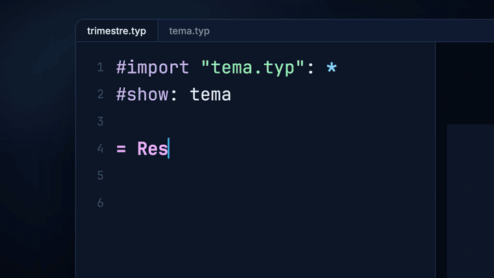

# Kern

**Editor y presentador nativo para [Typst](https://typst.app), con colaboración en tiempo real.**

Kern es una app de escritorio para escribir y presentar con Typst. Compila mientras escribes y
salta del código a la diapositiva y de la diapositiva al código. Trae vista de presentador,
apuntador láser, lupa y modo Vim. Se puede invitar a otras personas a editar el mismo proyecto en
tiempo real, con conexión cifrada, sin servidor ni cuentas. Para macOS, Linux y Windows.

> Este repositorio solo publica los paquetes de Kern. El código fuente aun no es público.

<p align="center">
  
</p>

## Descargar

En **[Releases](https://github.com/nekrum/kern/releases/latest)**:

| Sistema | Archivo |
|---|---|
| macOS (Apple Silicon e Intel) | `kern-<versión>-macos-universal.dmg` |
| Linux x86_64 | `kern-<versión>-linux-x86_64.tar.gz` |
| Windows x86_64 | `kern-<versión>-windows-x86_64.zip` |

Para comprobar una descarga: `shasum -a 256 -c SHA256SUMS.txt --ignore-missing`.

## Instalar

**macOS.** Abre el `.dmg` y arrastra **Kern** a **Aplicaciones**. Kern no está notarizado por
Apple: la primera vez ábrelo con clic derecho → **Abrir** (o en *Ajustes del Sistema →
Privacidad y seguridad → Abrir igualmente*).

**Linux.** Descomprime el `.tar.gz` y ejecuta `./kern`. Para tenerlo en el lanzador:

```sh
cp kern ~/.local/bin/
cp kern.desktop ~/.local/share/applications/
cp kern.svg ~/.local/share/icons/hicolor/scalable/apps/
```

Necesita `libxkbcommon`, `libxkbcommon-x11`, `fontconfig` y un driver Vulkan, y una glibc
reciente (Ubuntu 22.04 o posterior, o equivalente).

**Windows.** Descomprime el `.zip` y ejecuta `kern.exe`. Windows SmartScreen avisará porque no
está firmado: **Más información → Ejecutar de todas formas**. Al compartir o unirte a una sesión,
el firewall puede pedir permiso de red.

## Cómo funciona

<p align="center">
  
</p>

## Lo básico

| Tecla | Acción |
|---|---|
| ← → / espacio | diapositiva anterior / siguiente |
| `f` | pantalla completa |
| `p` | vista de presentador (notas, siguiente diapositiva, tiempo) |
| `a` · `z` · `b` | apuntador láser · lupa · pantalla en negro |
| `v` | pausar o reanudar el vídeo de la diapositiva |
| `e` / ⌘E (Ctrl+E) | editor del código |
| ⌘S (Ctrl+S) | guardar |
| ⌘R (Ctrl+R) | recargar del disco y recompilar (útil si otro programa o una IA cambió el archivo) |
| ⌘F · ⌘⇧F (Ctrl+F · Ctrl+H) | buscar · reemplazar |
| ⌘-clic (Ctrl-clic) en la diapositiva | ir al código que la produjo |
| ⌘⇧M (Ctrl+Shift+M) | chat de la sesión |

**Modo Vim:** *Editar → Modo Vim*.

**Colaborar:** *Colaboración → Compartir* copia un ticket; quien lo pega en *Colaboración →
Unirse* edita contigo. El anfitrión decide si hace falta admitir a cada persona, cuántas pueden
entrar y quién puede editar o solo mirar.

## GIF y vídeo

**GIF animado:** una imagen normal, `#image("demo.gif")`. Kern lo anima en la vista, el
presentador y la ventana de presentación.

**Vídeo** (por ahora solo en macOS): un metadato con la etiqueta `<kern>` justo antes de la
imagen que hace de póster:

```typst
#metadata((t: "Video", v: "demo.mp4")) <kern>
#image("poster.png", width: 80%)
```

`v` es la ruta del vídeo relativa a la carpeta del documento, y el archivo tiene que estar dentro
de ella. El vídeo se reproduce con audio encima del póster, en su mismo hueco, al entrar en la
diapositiva. Opciones: `loop: true` para repetirlo y `mute: true` para quitarle el sonido. Abre
los formatos que abre QuickTime (`.mp4`, `.mov`…).

En el PDF y las exportaciones se ve el GIF en su primer cuadro y, del vídeo, el póster; lo mismo
en Linux y Windows con el vídeo.

## Cambios

Ver [CHANGELOG.md](CHANGELOG.md) o las notas de cada release.

## Problemas y sugerencias

Abre un [issue](https://github.com/nekrum/kern/issues) con tu sistema, la versión de Kern y,
si puedes, un `.typ` pequeño que lo reproduzca.

## Licencia

Kern se puede usar gratis, también para trabajo comercial; ver [LICENSE](LICENSE). Incluye
bibliotecas y fuentes de terceros con sus propias licencias:
[THIRD-PARTY-LICENSES.html](THIRD-PARTY-LICENSES.html). Typst es una marca de sus autores; Kern
es un proyecto independiente.
